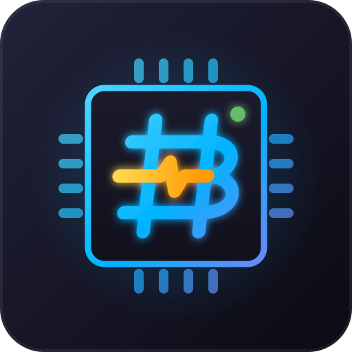
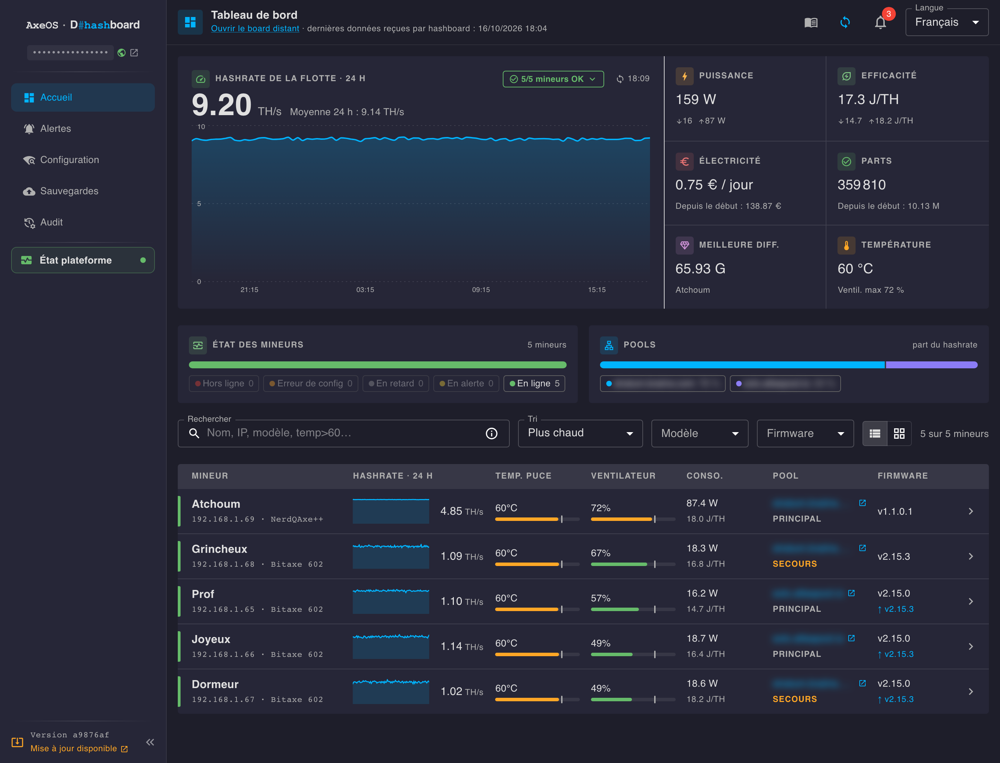
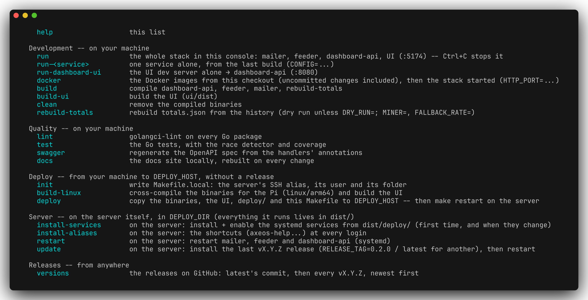
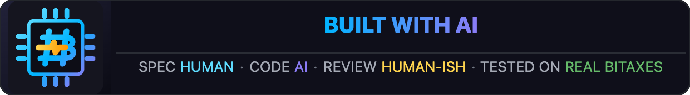

<p align="center">
  
</p>

# axeos-dashboard

📖 **[Documentation](https://joakim-ribier.github.io/axeos-dashboard/en/)** — supported models, tested firmware versions, full breakdown of every screen.

[](https://github.com/joakim-ribier/axeos-dashboard/actions/workflows/checks.yml)
[](https://github.com/joakim-ribier/axeos-dashboard/releases/tag/latest)
[](https://github.com/joakim-ribier/axeos-dashboard/releases/latest)
[](LICENSE)
[](server/go.mod)

Local dashboard and controller for [AxeOs](https://github.com/skot/ESP-Miner)-compatible Bitcoin ASIC miners — designed to run on a Raspberry Pi or any machine on your local network. No authentication: LAN use only.



> [!TIP]
> **Easy to use** — one line, everything else configured from the UI:
>
> ```bash
> curl -fsSL https://raw.githubusercontent.com/joakim-ribier/axeos-dashboard/main/docker-install.sh | IMAGE_TAG=latest bash
> ```

> [!NOTE]
> **Monitor your miners from anywhere** — push your stats to
> [hashboard.live](https://hashboard.live), free, no port to open or VPN to
> set up.

- [Prerequisites](#prerequisites)
- [Makefile](#makefile)
- [Testing](#testing)
- [Releases](#releases)
- [Deployment](#deployment)
- [API](#api)
- [Icons](#icons)
- [License](#license)

---

## Prerequisites

The Docker install needs Docker only. Development, or building the images
yourself, needs Go and Node:

```bash
apt install -y golang nodejs npm
```

How the feeder, dashboard-api, mailer and UI fit together: the
[Architecture page](https://joakim-ribier.github.io/axeos-dashboard/en/#architecture).

---

## Makefile

`make` alone lists every command, by where it runs:



Details: the [Makefile page](https://joakim-ribier.github.io/axeos-dashboard/en/makefile.html). `dashboard.yml`'s
fields: the [Installation page](https://joakim-ribier.github.io/axeos-dashboard/en/installation.html#config-file).

---

## Testing

```bash
make test               # Go -- standard library only (testing, httptest)
cd ui && npm run test   # UI -- Vitest + React Testing Library; npm run test:watch to watch
```

Every push to `main` and every pull request targeting it runs
[`checks.yml`](.github/workflows/checks.yml):

| Job | Steps |
|-----|-------|
| `go` | `go vet` → `golangci-lint` → `go test -race -cover` |
| `ui` | `npm run typecheck` → `npm run lint` → `npm run test` |

---

## Releases

When `checks.yml` succeeds on `main`, [`latest.yml`](.github/workflows/latest.yml)
builds every binary for `linux/arm64` (Raspberry Pi) and `linux/amd64` (VPS),
and the UI, into a rolling `latest` GitHub Release.

`make latest-update` installs it on the server.
A board's VPS takes the release's `remote-dashboard-api-amd64` and
`ui-dist.tar.gz`.

---

## Deployment

**With Docker** — the [Installation page](https://joakim-ribier.github.io/axeos-dashboard/en/installation.html): install,
fixed port, updating, pinning a version with `IMAGE_TAG`. `make docker`
builds the images from your checkout: the [Dev page](https://joakim-ribier.github.io/axeos-dashboard/en/dev.html).

**On your own server**, from a local build:

```bash
make init                # your machine: the server's SSH alias, user and folder, into Makefile.local
make deploy              # your machine: the binaries, the UI, deploy/ and the Makefile onto the server

# on the server, in its folder:
make install-services    # the first time, and when deploy/*.service change -- with the axeos-* shortcuts
make restart
```

nginx, once: `dist/deploy/nginx-axeos-dashboard.conf`, with your folder in
place of `@DEPLOY_DIR@`. Logs: `axeos-logs`.

---

## API

- This dashboard's (dashboard-api, remote-dashboard-api): the [API page](https://joakim-ribier.github.io/axeos-dashboard/en/api.html)
- The miners' (AxeOS): https://osmu.wiki/bitaxe/api/

---

## Icons

One pack for the app, the docs and [hashboard.live](https://hashboard.live):
[`brand/`](brand/README.md).

---

## License

[MIT](LICENSE) © Joakim Ribier

---

<p align="center">
  <a href="https://badele.github.io/build-with-ai/"></a>
</p>
